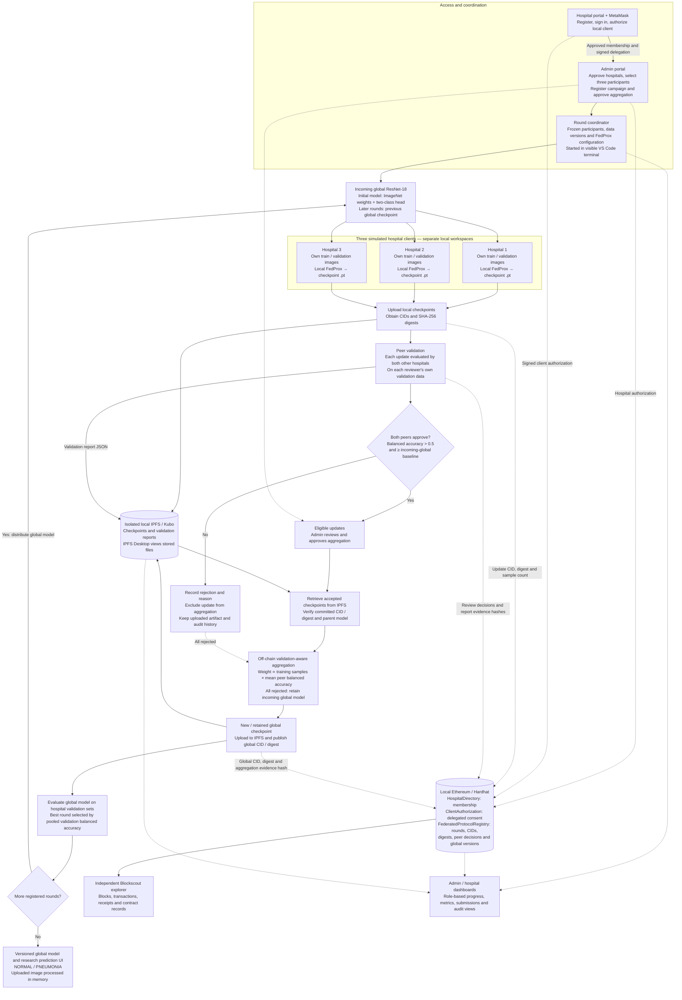

# Privacy Preserving Federated Learning for Multi-Institutional Pneumonia Prediction Using Blockchain

## Fed-Ledger architecture

This diagram describes the implemented local multi-hospital prototype. Three hospital workers run on this laptop; it is not yet a deployment across independent hospital systems. The current registered-campaign entry point is `round_coordinator.py`.

## How to read it

- **Solid arrows:** model, report or workflow flow. **Dashed arrows:** authorization, evidence or monitoring.
- **FedProx is local training.** The coordinator performs the separately documented validation-aware aggregation off-chain; Solidity does not train or average model tensors.
- For accepted update `i`, `weight_i = (n_i × mean_peer_balanced_accuracy_i) / sum_accepted(n_j × mean_peer_balanced_accuracy_j)`. Rejected updates have zero weight. Invalid or missing reviews reject the update.
- Each peer compares a candidate with the incoming global model on the same private validation partition. Test images do not determine acceptance, weights or best-round selection.
- IPFS stores model files and report JSON. Blockchain stores references, digests and attestations. Peer-report CIDs are retained in project artifacts; the peer-review transaction commits the report hash, not its CID directly.
- Raw X-rays stay in hospital workspaces and are not uploaded to IPFS or blockchain. Model sharing alone does not provide formal privacy guarantees.

## Main implementation files

| Layer | Files |
|---|---|
| Portals, membership and campaigns | `project_dashboard.py`, `hospital_management.py`, `portal_workflow.py` |
| Campaign orchestration | `round_coordinator.py` |
| Local hospital execution | `portal_workers.py`, `hospital_workers.py`, `fedprox_core.py` |
| Peer acceptance and aggregation policy | `peer_policy.py`, `architecture_protocol.json` |
| IPFS and integrity checks | `architecture_io.py` |
| Smart contracts | `blockchain/contracts/HospitalDirectory.sol`, `ClientAuthorization.sol`, `FederatedProtocolRegistry.sol` |
| Independent explorer | `blockchain/blockscout/` |

See [portal workflow](PORTAL_WORKFLOW_GUIDE.md) for operation and [project context](../PROJECT_CONTEXT.md) for experiment history and remaining limitations. This is a research prototype, not a clinical diagnostic system.
