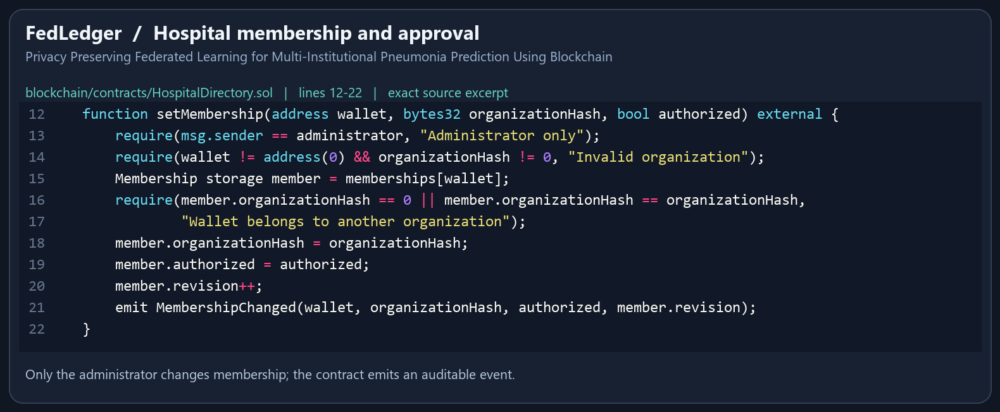
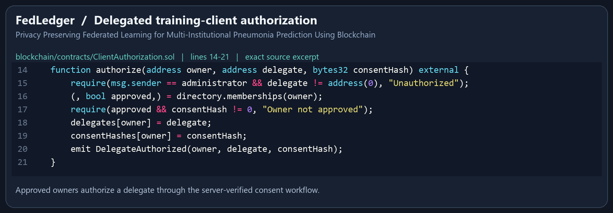
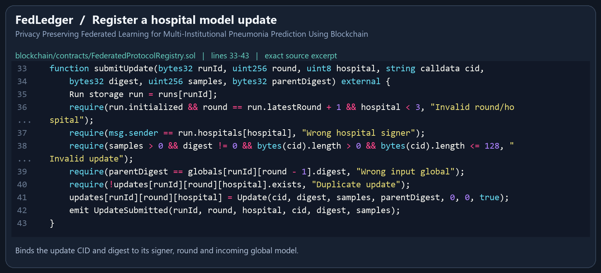
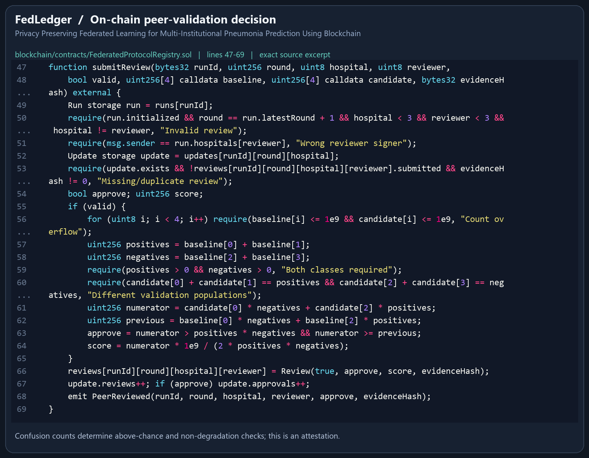
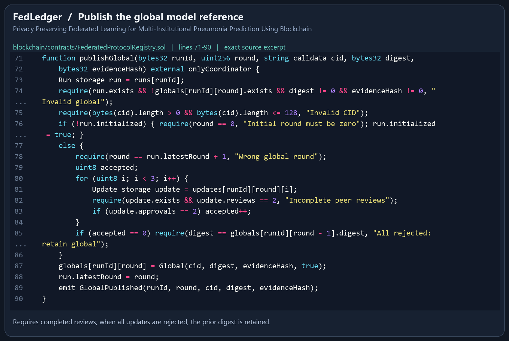
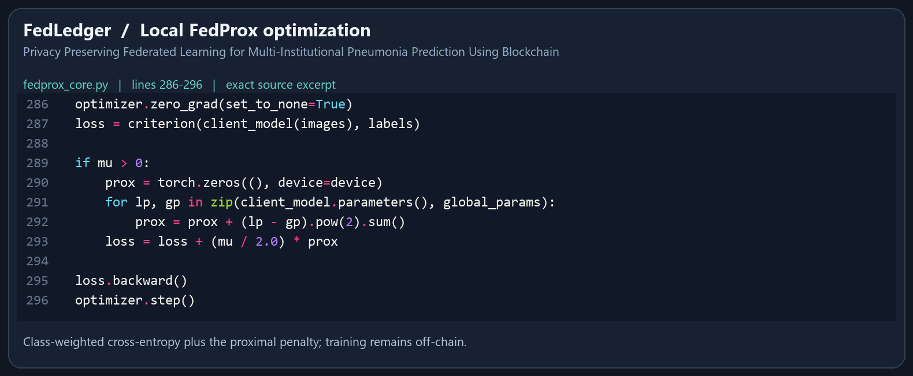
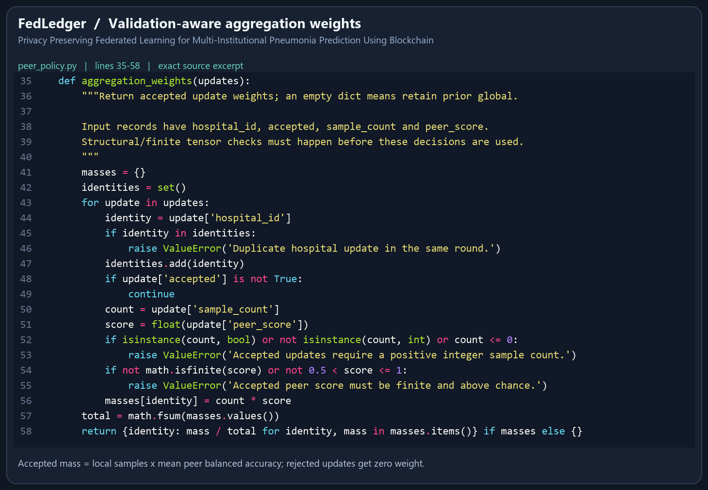
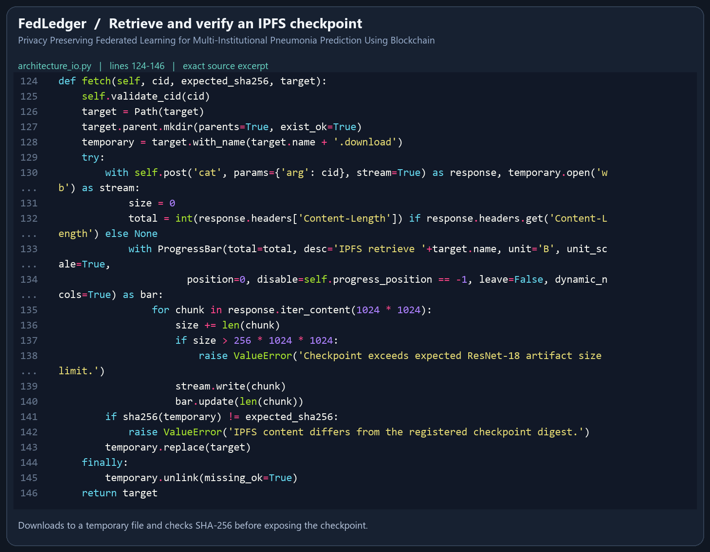

# Privacy Preserving Federated Learning for Multi-Institutional Pneumonia Prediction Using Blockchain

## Important implementation snippets

These PNGs are rendered from actual project source, not captures of VS Code. Line numbers and source SHA-256 hashes are recorded in `manifest.json`; wrapped display rows use `...`. The legacy `ModelRegistry.sol` is omitted because active campaigns use `FederatedProtocolRegistry.sol`.

### Hospital membership and approval

`blockchain/contracts/HospitalDirectory.sol` lines 12–22

Only the administrator changes membership; the contract emits an auditable event.

### Delegated training-client authorization

`blockchain/contracts/ClientAuthorization.sol` lines 14–21

Approved owners authorize a delegate through the server-verified consent workflow.

### Register a hospital model update

`blockchain/contracts/FederatedProtocolRegistry.sol` lines 33–43

Binds the update CID and digest to its signer, round and incoming global model.

### On-chain peer-validation decision

`blockchain/contracts/FederatedProtocolRegistry.sol` lines 47–69

Confusion counts determine above-chance and non-degradation checks; this is an attestation.

### Publish the global model reference

`blockchain/contracts/FederatedProtocolRegistry.sol` lines 71–90

Requires completed reviews; when all updates are rejected, the prior digest is retained.

### Local FedProx optimization

`fedprox_core.py` lines 286–296

Class-weighted cross-entropy plus the proximal penalty; training remains off-chain.

### Validation-aware aggregation weights

`peer_policy.py` lines 35–58

Accepted mass = local samples x mean peer balanced accuracy; rejected updates get zero weight.

### Retrieve and verify an IPFS checkpoint

`architecture_io.py` lines 124–146

Downloads to a temporary file and checks SHA-256 before exposing the checkpoint.

